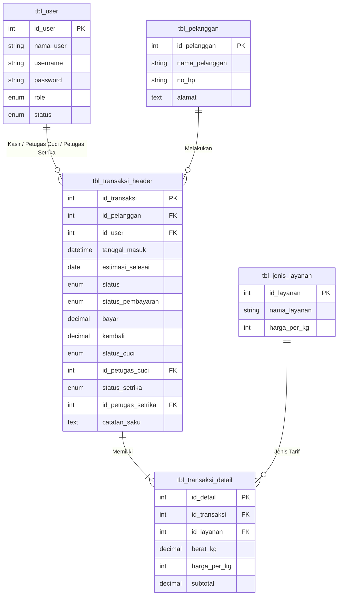

# 🧺 Laundryzky Management System (WPF Edition)

[](https://dotnet.microsoft.com/)
[](https://learn.microsoft.com/en-us/dotnet/desktop/wpf/)
[](https://www.mysql.com/)
[](#-alur-kerja-multi-role)

> **Sistem Manajemen Operasional & Kasir Laundry Modern Berbasis Desktop**  
> Didesain dengan arsitektur **Role-Based Access Control (RBAC)** dan pelacakan alur kerja terintegrasi (*end-to-end workflow tracking*) dari kasir hingga lantai produksi (pencucian & penyetrikaan).

---

## 📌 Ringkasan Proyek (Project Overview)

**Laundryzky** adalah aplikasi desktop enterprise yang dirancang untuk memecahkan masalah umum operasional bisnis laundry kiloan/satuan, seperti:
- Keterlambatan pelacakan pakaian pelanggan di lantai produksi.
- Hilangnya barang berharga di dalam saku pakaian pelanggan tanpa adanya pencatatan riwayat.
- Antrean menumpuk yang melebihi kapasitas gudang/mesin cuci (*overcapacity*).
- Ketidakjelasan akuntabilitas siapa karyawan yang mencuci dan siapa yang menyetrika.

Aplikasi ini dibangun menggunakan **C# .NET 10** dengan antarmuka **WPF (XAML)** yang modern, responsif, dan interaktif, terhubung langsung ke **MySQL Database**.

---

## 🌟 Fitur Utama & Keunggulan Arsitektur

### 1. 👥 Multi-Role Workflow Tracking (RBAC)
Sistem memisahkan antarmuka dan tanggung jawab secara ketat menjadi 4 peran kerja:
- **Administrator**:
  - Ringkasan statistik performa bisnis (Total Transaksi, Pesanan Diproses, Selesai, dan Akumulasi Omset).
  - Monitoring transparansi petugas produksi (siapa yang mencuci & menyetrika).
  - Manajemen karyawan (tambah user dengan role kasir/cuci/setrika, proteksi role admin, dan toggle status akun aktif/nonaktif).
  - Laporan keuangan fleksibel dengan filter tanggal (*Date Range*) dan fitur cetak laporan ke format dokumen/PDF.
  - Fitur darurat *Reset Data Transaksi & Pelanggan* dengan konfirmasi ganda aman.
- **Kasir (Front Office)**:
  - Form transaksi kasir interaktif dengan kalkulasi otomatis subtotal dan uang kembalian.
  - Validasi input ketat (hanya angka positif, tolak karakter huruf/minus).
  - Pratinjau nota digital otomatis bergaya struk (*Thermal Receipt Window*) sebelum dicetak fisik/PDF.
  - Manajemen data pelanggan lengkap dengan pencarian data instan (*Real-time Search*).
- **Petugas Cuci (Washing Department)**:
  - Antrean cucian masuk khusus pakaian yang membutuhkan pencucian.
  - Pencatatan nama petugas cuci secara otomatis saat tugas diambil.
  - Form pencatatan saku (*Pocket Note*) untuk mendata barang temuan pelanggan.
- **Petugas Setrika (Ironing & Finishing Department)**:
  - Antrean tugas penyetrikaan dengan validasi alur kerja berurutan.
  - Mode *Monitor Semua Progres* untuk memantau status pengerjaan keseluruhan antrean.

---

### 2. 🛡️ Aturan Bisnis & Safeguards (Defensive Engineering)
- **Work-In-Progress (WIP) Limit**: Membatasi antrean aktif maksimal **20 transaksi** berjalan untuk menjaga kualitas cucian dan kapasitas operasional.
- **Limit Kapasitas Berat Cucian**: Validasi maksimal **50 Kg per transaksi** guna menjaga keawetan mesin cuci komersial.
- **1 Order Aktif per Pelanggan**: Pelanggan yang masih memiliki pakaian yang sedang diproses atau belum diambil tidak dapat membuat transaksi baru (mencegah penumpukan piutang/pakaian).
- **Service-Aware Dependency Logic**:
  - Jika pelanggan memilih layanan *"Setrika Saja"*, sistem otomatis menandai status cuci sebagai `Tidak Perlu` dan langsung menugaskannya ke bagian setrika.
  - Jika pelanggan memilih *"Cuci Saja"*, pakaian tidak perlu disetrika dan langsung berstatus `Selesai` setelah dicuci.
  - Bagian setrika **tidak dapat** menyelesaikan penyetrikaan jika pakaian belum selesai dicuci oleh bagian cuci.
- **Konfirmasi Tindakan Krusial (*Finishing Action Warnings*)**:
  - Seluruh tombol penting (Logout, Simpan Transaksi, Ambil Tugas, Selesai Tugas, Simpan Catatan, Ubah Status Karyawan) dilengkapi dialog konfirmasi `Yes/No` untuk mencegah ketidaksengajaan klik.
- **Format Teks Bersih (Zero Underscore UI)**:
  - Seluruh status sistem dari database ditampilkan ke antarmuka dengan frasa bahasa Indonesia yang rapi (contoh: *Sedang Dicuci*, *Sedang Disetrika*, *Tidak Perlu*, *Belum Bayar*, *Lunas*).

---

## 🏗️ Struktur Relasi Database (Schema Overview)

Aplikasi menggunakan skema relasional InnoDB yang ternormalisasi dengan integritas data (*Foreign Keys* dan *Cascade*):



---

## 🔑 Kredensial Uji Coba Default (Demo Accounts)

Semua akun sudah disiapkan dalam file `database.sql`:

| Peran (Role) | Username | Password | Deskripsi Tanggung Jawab |
| :--- | :--- | :--- | :--- |
| **Administrator** | `admin` | `admin123` | Akses penuh, statistik omset, kelola user & cetak laporan |
| **Kasir** | `kasir` | `kasir123` | Registrasi pelanggan, transaksi baru, & cetak nota digital |
| **Bagian Cuci** | `cuci` | `cuci123` | Penerimaan cucian kotor, cuci basah, pengeringan, & catatan barang |
| **Bagian Setrika** | `setrika` | `setrika123` | Penyetrikaan rapi, kontrol kualitas pakaian, & penyelesaian order |

---

## 🚀 Panduan Instalasi & Menjalankan Proyek

### Prasyarat:
1. **.NET 10.0 SDK** terinstal di sistem Windows.
2. **MySQL Server / XAMPP / MariaDB** aktif di port default `3306`.
3. IDE: Visual Studio 2022+ / Visual Studio Code dengan ekstensi C#.

### Langkah-langkah:
1. **Clone Repositori**:
   ```bash
   git clone https://github.com/rizkydika544-debug/LaundryzkyAppNewWPF.git
   cd LaundryzkyAppNewWPF
   ```

2. **Setup Database**:
   - Buka phpMyAdmin / MySQL Workbench / Terminal MySQL.
   - Impor file [`database.sql`](./database.sql) yang tersedia di root folder.

3. **Konfigurasi Koneksi (Jika Diperlukan)**:
   - Pengaturan koneksi berada di file `LaundryzkyWPF/Koneksi.cs`:
     ```csharp
     public static string ConnectionString => "server=localhost;user=root;password=;database=laundryzky;";
     ```

4. **Jalankan Aplikasi**:
   ```bash
   dotnet build
   dotnet run --project LaundryzkyWPF/LaundryzkyWPF.csproj
   ```

---

## 👨‍💻 Kontribusi & Pengembang

Dikembangkan sebagai proyek portofolio software engineering desktop berstandar produksi yang mengedepankan **clean architecture**, **data validation**, dan **intuitive user experience**.
